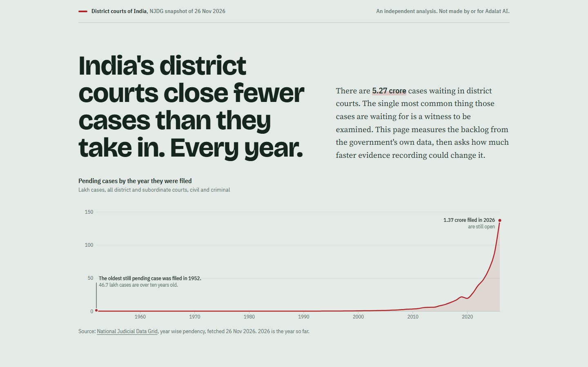
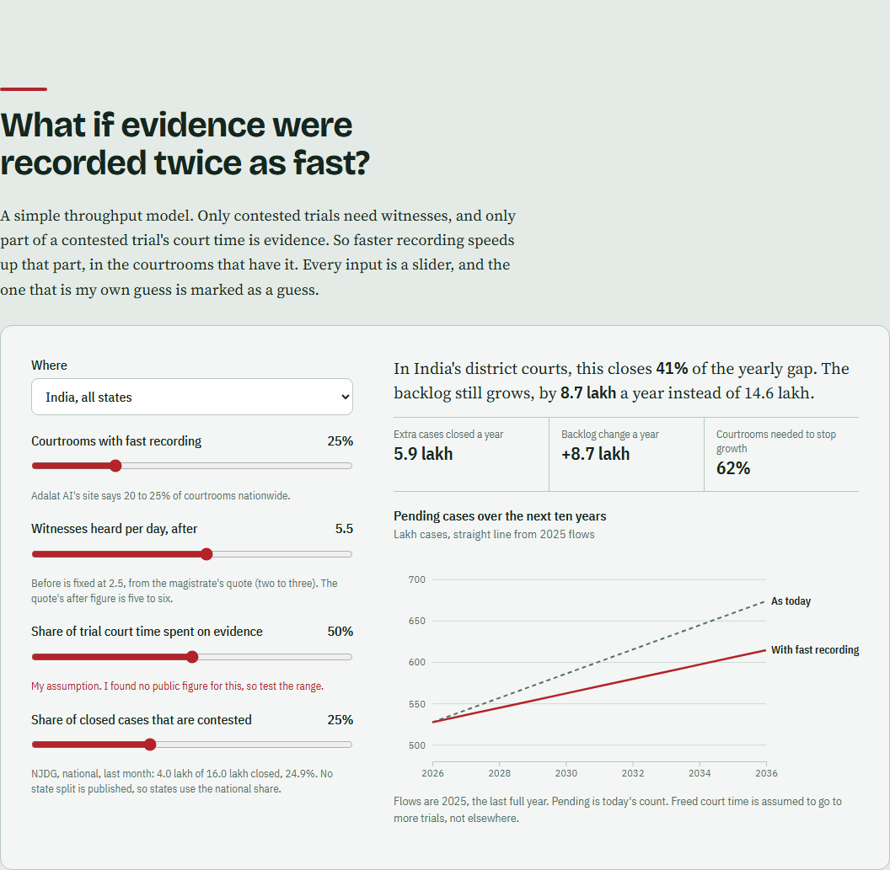

# Where India's court cases wait



**Problem:** India's district courts have 5.27 crore pending cases, and nobody outside the system can easily see where they are stuck or what a faster courtroom would change.

**Result:** From the live NJDG numbers (snapshot 26 Nov 2026):
- District courts took in more cases than they closed in every year from 2018 to 2026. In 2025 the gap was 14.6 lakh cases.
- The most common stage a pending case is waiting at is **witness examination: 92.2 lakh cases**, 18.9% of cases with a recorded stage.
- Using Adalat AI's own public figures (a magistrate going from 2 to 3 witnesses a day to 5 to 6, in about 25% of courtrooms), faster evidence recording closes about **41% of the yearly gap**. Stopping the backlog growing would take about **62% of courtrooms**, if half of a contested trial's court time is evidence. That last input is my assumption, and it is a slider.
- NJDG disagrees with itself in a few places, one by almost 10 lakh cases. The page lists every check.

**[Try it live: adalat-court-analytics.vercel.app](https://adalat-court-analytics.vercel.app)**



## Data sources
| What | Where |
|---|---|
| Pending cases, age, filing year, stage, delay reasons, yearly filed vs closed, per state | [National Judicial Data Grid, district courts](https://njdg.ecourts.gov.in/njdg_v3/) (eCommittee, Supreme Court of India), fetched 26 Nov 2026 |
| Contested share of disposals (24.9%) | NJDG homepage, "Contested, % of disposal in last month" |
| Witnesses per day before and after (2.5 and 5.5) | [adalat.ai](https://www.adalat.ai) homepage, quote from a Judicial Magistrate: "two to three ... five to six" |
| Courtroom coverage (25%) | [adalat.ai](https://www.adalat.ai) homepage, "20-25% courtroom coverage nationwide" |

The raw snapshot is committed in `raw/njdg_2026-11-26.json`, exactly as NJDG returned it.

## Method
1. `scripts/fetch_njdg.py` opens the NJDG dashboard in headless Chromium and calls the dashboard's own `ajaxCall()` endpoints (`home/newPendDashboard`, `home/pendingCasesState`, `home/fetchStateData`, `home/stagewiseState`) for India and all 36 states and UTs. NJDG has no public API, so this is the same request a visitor's click makes. Nothing is parsed at this step.
2. `scripts/build_data.py` parses the raw file into `site/data.json` (32 KB) and runs the reconciliation checks.
3. `site/index.html` is a static page (D3 7.9) that reads `data.json`. All numbers in the text are computed from it at load.

The model, per contested case: speed up = 1 / ((1 − e) + e × before / after), where e is the share of trial court time spent on evidence. Extra closures a year = 2025 closures × contested share × coverage × (speed up − 1). Backlog change = 2025 filings − (2025 closures + extra).

## Assumptions and caveats
- **Evidence share (default 50%) is my assumption.** I found no public figure. The slider runs 10% to 90%.
- Contested share is one month of national data, applied to every state because NJDG does not publish a state split.
- The model is throughput only: it ignores adjournments, judge vacancies, and changes in filings. Freed court time is assumed to go to more trials.
- 2026 is a partial year. NJDG coverage has grown since 2018, so early years may undercount.
- Uttar Pradesh closed more than it received in 2025, but its 2026 filings so far are already 41% above all of 2025.
- District and subordinate courts only. High Courts and the Supreme Court are not included.

## How to run
```bash
pip install playwright pandas lxml && python -m playwright install chromium
python scripts/fetch_njdg.py      # about 1 minute, writes raw/njdg_<date>.json
python scripts/build_data.py      # writes site/data.json and prints every check
python -m http.server -d site 8000
```
`scripts/shoot.py` takes the 1440 and 390 px screenshots used for layout checks. Design choices are in `DESIGN_NOTES.md`.

Independent work by Nitesh Kumar Yadav (B.Tech ECE, AI and ML, NSUT Delhi) using public data. Not affiliated with Adalat AI or the eCommittee.
